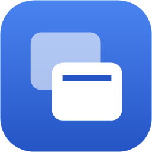

<p align="center"></p>

<h1 align="center">Claude Desktop Multi-Account for Windows</h1>

<p align="center">
Run two (or more) <b>Claude Desktop</b> accounts <b>side by side on Windows</b>, such as work and personal.<br>
Each account gets its own window, its own taskbar button and its own colored icon.<br>
One small <code>.exe</code>: no installer, no admin rights, no extra runtime.
</p>

<p align="center">
<a href="../../releases/latest"></a>

<a href="LICENSE"></a>
</p>

> **Unofficial.** This is a community tool. It is not made, endorsed or supported by Anthropic.
> "Claude" is a trademark of Anthropic. The tool only starts the official Claude Desktop app that is already installed on your PC.

## Why

Claude Desktop runs one account at a time. Signing out and back in to switch between a work and a personal account gets old fast.
A second copy of the app normally just brings the first window to the front. When you do get a second instance running,
**Google sign-in returns to the wrong window**, because Windows always hands the `claude://` sign-in link to the main app.

This launcher solves all of that.

## Features

- 🪟 **Separate instance:** each account runs in its own Claude Desktop window, with its own sign-in, chats, Cowork and Code sessions, and settings.
- 📌 **Own taskbar button:** each account has its own taskbar group, named "Claude (Account 2)" and so on, so it never merges with the main Claude button. You can pin it.
- 🎨 **Colored icon per account:** blue, green, purple and more. The icon is made on your PC by recoloring the Claude icon of the installed app. No Anthropic artwork is shipped with this tool.
- 🔑 **Google sign-in that lands in the right window:** the launcher catches the sign-in link and forwards it to the account that asked for it. Email sign-in works as usual.
- ➕ **As many accounts as you like:** copy the exe and give it another name.
- 🧳 **Single file, about 40 KB:** written in C# against the .NET Framework 4 that ships with every Windows 10/11, and built by GitHub Actions from this source.
- 🏪 Works with both the **Microsoft Store/MSIX** build and the older installer build of Claude Desktop.

## Quick start

1. Install [Claude Desktop](https://claude.ai/download) and sign in with your **main** account as usual.
2. Download **`Claude-Account-2.exe`** from the [latest release](../../releases/latest).
3. Move it to a permanent folder, for example `C:\Tools\Claude\`. The shortcuts point to this file, so don't leave it in Downloads.
4. Double-click it. On the first run, Windows may show *"Windows protected your PC"* because the exe is not code-signed. Click **More info**, then **Run anyway**.
5. A new Claude window opens. Sign in with your **second** account:
   click *Continue with Google*, finish in the browser, then allow the browser to open Claude. You land in the new window.

The first run also adds a **Claude (Account 2)** shortcut to the Start menu and the desktop. Use those from now on.

## More accounts

The account name comes from the file name, and dashes or underscores read as spaces. Copy the exe and rename the copy:

| File name               | Shows up as          | Icon color |
|-------------------------|----------------------|------------|
| `Claude-Account-2.exe`  | Claude (Account 2)   | blue       |
| `Claude-Account-3.exe`  | Claude (Account 3)   | green      |
| `Claude-Account-4.exe`  | Claude (Account 4)   | purple     |
| `Claude-Work.exe`       | Claude (Work)        | picked from the name |

Every name is a separate account with its own data folder.

## How it works

| What                 | How |
|----------------------|-----|
| Separate instance    | Starts the installed Claude Desktop with Electron's `--user-data-dir`, pointing to `%USERPROFILE%\Claude-Accounts\<name>\data`. A different data folder also means a separate single-instance lock. AppData is not used, because the Store build of Claude silently redirects AppData writes into its private package folder. |
| Own taskbar group    | While the account is open, the launcher stays in the background as a small helper (about 25 MB of memory, negligible CPU) and gives each of its windows its own [AppUserModelID](https://learn.microsoft.com/windows/win32/shell/appids) and relaunch properties through `SHGetPropertyStoreForWindow`. The Start menu shortcut carries the same ID, which is how Windows names the button. |
| Colored icon         | On first run it extracts the icon from the installed `Claude.exe`, shifts the hue, and saves it as `icon-<hue>.ico` in the account folder. Windows get it through `WM_SETICON`. |
| Google sign-in       | When the account's own log shows it opened the browser for sign-in, the launcher watches for the short-lived (~0.2 s) Claude process that carries the `claude://login/…` link, for up to 10 minutes. It then passes the link to the right instance. The main app also gets the link, sees it didn't start that sign-in, and ignores it. Outside a sign-in there is no fast polling. |
| Clean exit           | The launcher exits about 15 seconds after the account's window is closed. |

## Privacy and safety

- **No network access.** The launcher never connects to anything, and it sends no telemetry.
- **What it reads:**
  - its own account's log file;
  - the command line of running `claude.exe` processes, only during a sign-in, to find the sign-in link.
- **What it writes:** only its account folder (`%USERPROFILE%\Claude-Accounts\<name>`) and the two shortcuts.
- **Your sign-in stays inside the official app:** tokens are stored by Claude Desktop itself, encrypted per Windows user.
- **The source is about 800 lines** in [`src/ClaudeMultiAccount.cs`](src/ClaudeMultiAccount.cs). The release binary is built from it by GitHub Actions, and its SHA-256 hash is listed in each release.

## Good to know

- **Settings are per account** and start at their defaults. That includes options such as the permission mode for Code sessions, so set them again in that window's Settings.
- **The tray icon** (next to the clock) keeps the original Claude look.
- **Other `claude://` links** from websites, other than sign-in, open in the main Claude app.
- **Claude Code's own settings, memory and transcripts** in `%USERPROFILE%\.claude` are shared by all accounts on the PC.
- **A new PC means signing in again.** Sign-ins are encrypted per Windows user, so they cannot be copied to another PC.
- **If a Claude update changes the sign-in log message,** Google sign-in forwarding stops working until this tool is updated. Email sign-in keeps working. Please [open an issue](../../issues) if that happens.

## Uninstall

1. Quit that account's Claude: right-click its tray icon, then choose **Quit**.
2. Delete the exe.
3. Delete the **Claude (Account 2)** shortcuts from the desktop and the Start menu.
4. Delete `%USERPROFILE%\Claude-Accounts\<name>`.

Nothing else is changed on your system: no registry keys and no services.

## Build from source

```powershell
powershell -ExecutionPolicy Bypass -File build.ps1
```

This produces `dist\Claude-Account-2.exe` with `csc.exe` from the .NET Framework 4 that ships with Windows. No SDK is needed.
`tools\New-AppIcon.ps1` redraws the exe's own icon (`assets\app.ico`).

## Ringkasan (Bahasa Indonesia)

Alat ini menjalankan **dua akun Claude Desktop atau lebih sekaligus di Windows**:
- setiap akun punya jendela, tombol taskbar dan ikon berwarna sendiri;
- login Google otomatis masuk ke jendela yang benar.

Cara pakai:
1. Pasang Claude Desktop, lalu login akun utama.
2. Unduh `Claude-Account-2.exe` dari halaman *Releases* dan simpan di folder tetap.
3. Klik dua kali exe-nya. Kalau muncul peringatan Windows, pilih *More info*, lalu *Run anyway*.
4. Login akun kedua di jendela yang baru terbuka.

Untuk akun ketiga, salin exe-nya dan ganti namanya menjadi `Claude-Account-3.exe`; contoh lain: `Claude-Kantor.exe`.
Data setiap akun ada di `%USERPROFILE%\Claude-Accounts\<nama>`. Ini alat komunitas, bukan produk resmi Anthropic.

## License

[MIT](LICENSE)
